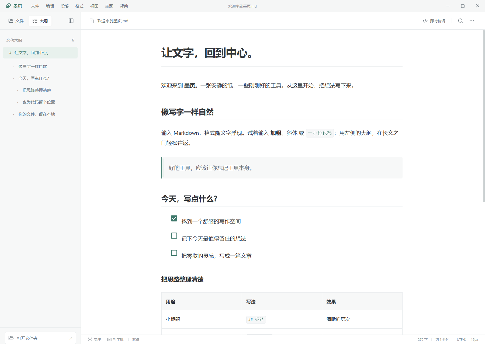

# 墨页 Moye

一个面向 Windows 的本地 Markdown 编辑器，支持边写边预览、源码编辑和 PDF / HTML 导出。文稿使用普通 Markdown 文件保存，适合记笔记、写文档和日常办公。

[下载与启动](#下载与启动) · [使用说明](#第一次使用) · [开发者与 AI 入口](docs/development/README.md)

## 下载与启动

**[前往 Releases 下载 Windows 版](https://github.com/whitemoker/moye/releases)**

1. 在最新版本的 **Assets** 中下载 `Moye-版本号-Windows-x64.zip`。
2. 右键压缩包，选择“全部解压”。
3. 打开解压后的文件夹，双击 `Moye.exe`。

这是 Windows x64 便携版，无需安装，也无需安装 Node.js。请保留整个解压文件夹，不要只复制其中的 EXE。GitHub 自动生成的 `Source code (zip)` / `Source code (tar.gz)` 是源码，需要自行构建。

分享给朋友时，可以直接发送 [项目首页](https://github.com/whitemoker/moye) 或 [下载页面](https://github.com/whitemoker/moye/releases)。写作和保存本地文件无需联网；文稿里的网络图片与外部链接仍需要网络。

## 第一次使用

1. **开始写作**：按 `Ctrl+N` 新建文稿，直接输入文字。输入 `#` 加空格可创建一级标题。
2. **打开已有文稿**：按 `Ctrl+O` 打开 Markdown / 文本文件，也可以把文件拖进窗口。按 `Ctrl+Shift+O` 打开一个写作文件夹。
3. **保存文稿**：按 `Ctrl+S`。首次保存会根据标题或首段建议文件名；没有内容时使用“未命名”。按 `Ctrl+Shift+S` 可以另存为。
4. **调整文字格式**：使用顶部“段落”“格式”菜单，或选中文字后右键。仅选中文字不会自动弹出工具栏。
5. **调整外观**：右上角三个点可设置主题、字号、文稿宽度和字体；主题也能从顶部“主题”菜单切换。
6. **分享成品**：在“文件”菜单中选择“导出 PDF”或“导出 HTML”。

软件内也有说明：**帮助 → 快捷键与使用说明**。鼠标停在图标上可以查看简短提示。

## 常用功能

- **即时编辑 / 源代码**：`Ctrl+/` 在两种编辑方式之间切换。
- **文件与大纲**：侧边栏可查看文件、最近打开的文稿和标题大纲；`Ctrl+P` 按名称快速打开。
- **Markdown 格式**：标题、引用、列表、任务清单、代码块、表格、图片、链接和数学公式。
- **查找与替换**：`Ctrl+F` 查找，`Ctrl+H` 查找与替换。
- **专注模式**：`F8` 突出当前段落或整组内容，周围文字轻微淡化。
- **打字机模式**：`F9` 让当前输入行保持居中；拖选文字时暂停跟随。
- **三种主题**：素白、暖纸、深夜。
- **自动保存与草稿恢复**：已有保存位置的文稿在停止输入后自动保存；新文稿需先手动选择位置。启动时可恢复检测到的未保存草稿。

### 图片和表格

- 图片支持粘贴、拖放，或通过“格式 → 插入图片”添加。
- 插入本地图片前需先保存文稿；图片保存在文稿旁的 `文稿名.assets` 文件夹中。分享原始文稿时，请同时分享这个素材文件夹。
- 从“段落 → 表格”插入表格，使用表格的悬浮菜单增删行列。
- 按住 `Ctrl` 点击文稿中的链接可以打开它。

### Windows 文件图标与打开方式

在右上角三个点的写作设置中，点击“注册图标与打开方式”。之后可以在资源管理器中右键 Markdown 文件，通过“打开方式”选择墨页。

注册使用当前 Windows 用户的设置，不会强制更改默认应用。若希望双击文件就用墨页打开，请在 Windows 的“打开方式”中自行设为默认。移动软件文件夹后，可重新注册。

## 文件与兼容性

- 当前版本提供 Windows x64 构建，其他平台尚未验证。
- 支持 UTF-8 Markdown / 文本文件，单个文稿最多 20 MB；不自动转换其他文本编码。
- 编辑后会规范化部分 Markdown 空白与标记。复杂图表暂以代码显示，不支持的扩展语法建议使用源码模式。
- 检测到文件被其他程序修改或删除时，会暂停自动保存，可选择载入磁盘版本、另存为或确认覆盖。
- 公司文档加密或终端管控可能限制应用读取文件；需要由公司 IT 按规定授权，墨页不会绕过这些策略。
- 便携版的“免安装”指程序本身无需安装。设置和恢复草稿仍保存在当前用户的应用数据目录中，不随软件文件夹迁移。

## 参与开发

想了解墨页的设计方式、与 AI 协作的流程，或从源码运行和修改项目，请从 **[开发者与 AI 入口](docs/development/README.md)** 开始。

## 许可证

本项目采用 **Apache License 2.0 + Commons Clause 1.0**，两部分同时适用，完整条款见 [LICENSE](LICENSE)。允许个人及公司内部免费办公使用；销售限制以 LICENSE 中的 Commons Clause 定义为准。

这不是仅使用 Apache-2.0 的项目，也不属于 OSI 定义的开源许可证。第三方依赖仍遵循各自的许可证，发行包内包含第三方许可说明。
